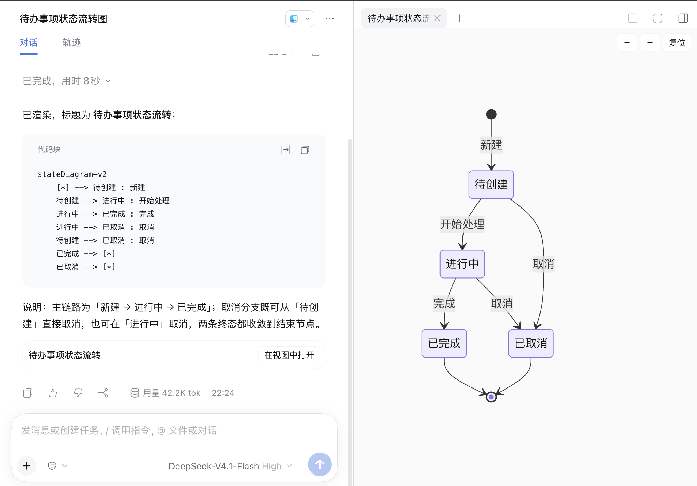
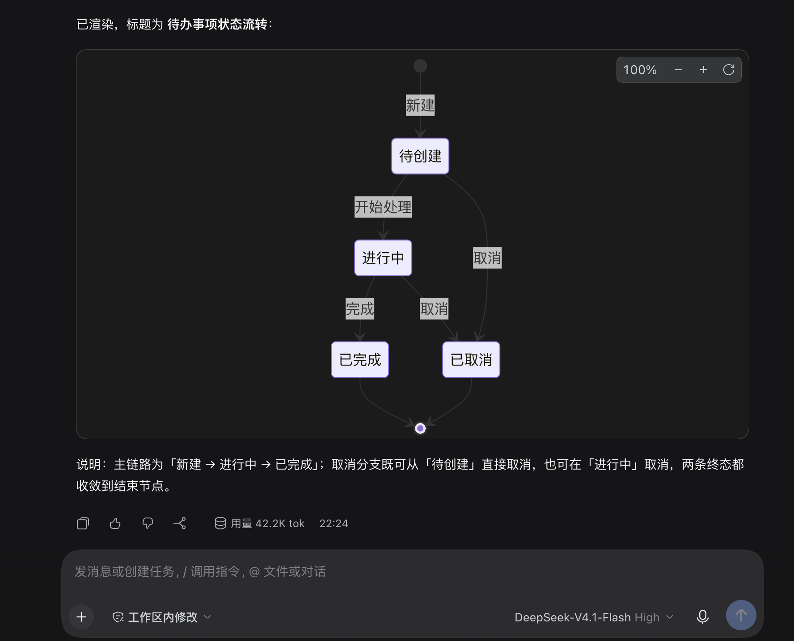

# dsh-mermaid

<!-- Bump the badge with the @deepseek-ai/dsh-tools peerDependency. -->
[](https://github.com/deepseek-ai/deepseek-harness/releases/tag/dsh-v0.2.1-alpha.2)
[](./LICENSE)

<!-- 最近一次验证的 DeepSeek Harness 版本；兼容性下限仍以 @deepseek-ai/dsh-tools 的 peerDependency 为准。 -->
最近一次验证：DeepSeek Harness 0.2.1-rc.2，CI 以该版本执行 typecheck 与构建。

面向 DeepSeek Harness 的 Mermaid 图表插件：模型经 `mermaid_render` 工具出图，图表以“会话中产物”常驻回合末尾，点开即得右侧边栏的缩放大画布。单包发布、自带渲染引擎，上游 DSH 无需任何改动。

## 安装

```sh
dsh plugin --profile web add github:Preference-cmd/dsh-mermaid
```

安装后重启该 profile。包内自带构建产物，pnpm 无需构建权限。

## 它做了什么

- **`mermaid_render` 工具**（宿主侧）：接受图源和可选的短 `title`，原样返回 ```mermaid 围栏，并把 `{ source, title? }` 持久化到结果元数据里，重放时按同一来源重绘；无解析器、无无头浏览器。
- **转录卡片**（浏览器侧）：先把图源交给客户端的围栏渲染器，客户端不支持时用自带引擎绘制。SVG 以 React 元素进入页面——引擎在 `securityLevel: 'strict'` 下净化输出，丢弃全部 `on*` 属性与 `javascript:` URL，不使用 `dangerouslySetInnerHTML`。
- **回合末尾产物行**（浏览器侧）：从会话日志回放已定稿的图，按标题常驻在回合收尾消息之后，不展开过程流也可见。
- **侧栏查看器**（浏览器侧）：点“在视图中打开”进入右侧边栏大画布，滚轮缩放、拖拽平移；同一调用的图重复打开会聚焦同一个标签页。



## 为什么无法做到这样

助手自己手写的 mermaid 围栏无法在上游渲染成图：官方仓库的 Markdown 渲染器没有为代码围栏留出扩展插槽，本插件无法替它画。所以插件选择了另一条路——`mermaid_render` 的结果经自己的卡片与查看器渲染（见上）。在带围栏渲染器的客户端里（下图为作者分支），同样的围栏无需任何插件即可直接成图：



参考：[DeepSeek Harness 插件教程](https://deepseek-harness.github.io/deepseek-harness/develop/basic/publish)。

## 许可证

本项目以 [MIT](./LICENSE) 许可证发布。
